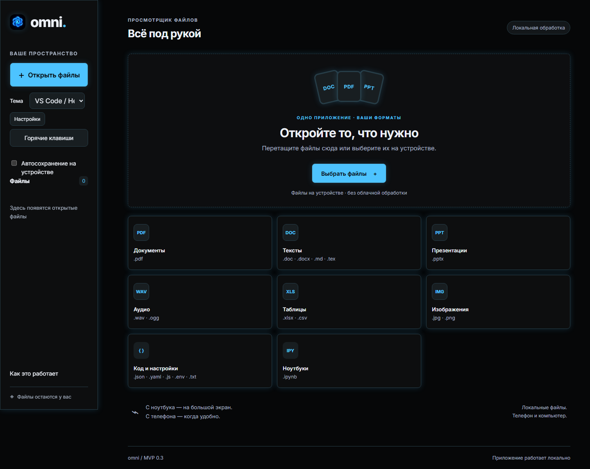
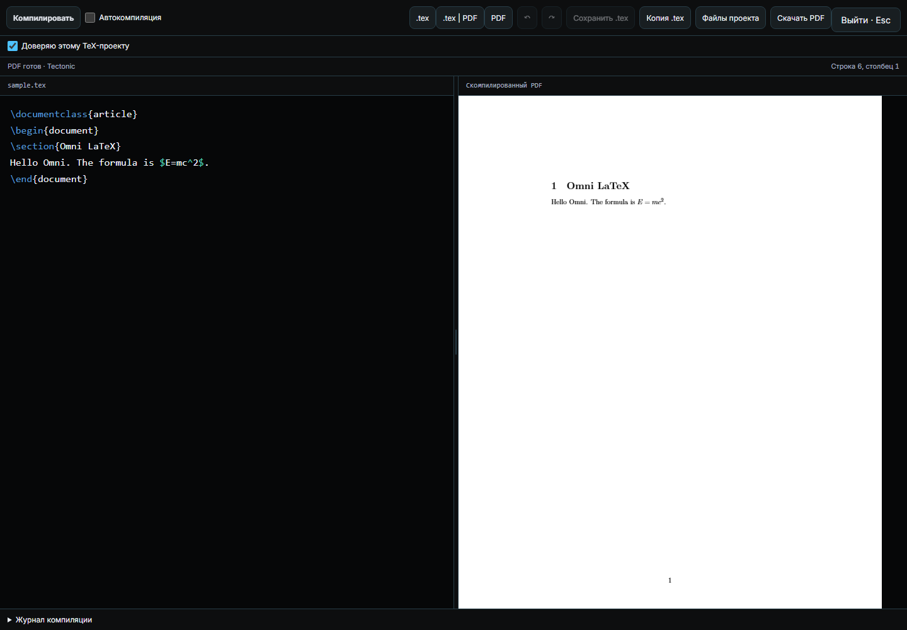

# Omni Reader

<p align="center"></p>

Локальный просмотрщик и редактор документов для браузера, Windows и Android.
Версия **0.3.0**. Содержимое открытых файлов обрабатывается на устройстве.



## Возможности

| Формат | Возможности |
| --- | --- |
| PDF | Просмотр, поиск, поворот и удаление страниц; экспорт текстового слоя в XLSX/CSV |
| DOCX, PPTX | Просмотр и правка основного текста, оформление, страницы и слайды, отмена и повтор |
| XLSX, CSV | Просмотр таблиц, редактирование ячеек, сохранение копии |
| JPG, PNG | Обрезка, поворот, рисование, конвертация в изображение или PDF |
| WAV, OGG | Воспроизведение; редактирование PCM16 WAV и конвертация OGG в WAV |
| LaTeX (.tex) | Исходник и скомпилированный PDF рядом; три режима, правка и сохранение на месте, локальная компиляция Tectonic |
| Markdown, Jupyter | Предпросмотр текста и формул; редактирование Markdown и ячеек notebook без исполнения кода |
| TXT, JSON, YAML, JS, ENV | Просмотр и редактирование исходного текста с подсветкой синтаксиса |

Есть темы, горячие клавиши, полноэкранный режим и сохранение локальных копий.
На Windows доступно локальное распознавание аудио через Whisper с отдельно установленной моделью.

## Быстрый запуск

Нужен **Node.js 22.12+** с npm. Python **3.11+** нужен для тестов распознавания;
для самого просмотра документов Python не требуется.

```sh
git clone https://github.com/Klio-de-Janeiro/omni_reader.git
cd omni_reader
npm ci
npm run build
npm start
```

Откройте **http://127.0.0.1:4173**. Для остановки сервера нажмите Ctrl+C.
Сервер по умолчанию слушает только локальный интерфейс.

На Windows можно запустить `START_WEB.cmd`: готовые ресурсы уже находятся в `dist/`,
поэтому для этого способа установка npm-зависимостей не нужна.
Не открывайте `dist/index.html` напрямую: приложению нужен HTTP-сервер или Electron.

## Windows

`START_WINDOWS.cmd` запускает приложение в отдельном окне.
`BUILD_WINDOWS.cmd` собирает установщик для Windows 10/11 x64:

```text
release/windows/Omni-Reader-0.3.0-Windows-Setup.exe
```

При первой установке зависимостей и инструментов сборки нужен интернет.
Установщики и локальные инструменты не хранятся в Git.
Для сборки используйте путь без `&` и других командных спецсимволов:
обновлённый electron-builder отклоняет такие пути к инструментам.
Настройка распознавания, Python, FFmpeg и моделей: [Whisper на Windows](WHISPER_DESKTOP_RU.md).
Сохранённые пути Whisper можно изменить в настройках приложения для своего компьютера.

## Редактор LaTeX

Откройте `.tex`: исходный текст будет слева, скомпилированный PDF — справа.
Кнопки **.tex**, **.tex | PDF** и **PDF** переключают расположение без потери правок.
**Ctrl+Enter** компилирует текущий черновик; **Ctrl+S** сохраняет исходник на месте.
Доступны автокомпиляция, изменение ширины панелей, журнал ошибок и скачивание PDF.

Для исходного проекта установите локальный движок один раз:

```sh
npm run latex:setup
```

Установщик Windows включает Tectonic автоматически. При первом использовании
пакеты LaTeX скачиваются в локальный кэш; содержимое документа никуда не отправляется.
Компилируйте доверенные проекты: локальный TeX имеет доступ к файлам компьютера.
В браузере сохранение на месте требует разрешения на файл; иначе доступна копия.
На Android исходник редактируется, а компиляция требует настольной версии.
Подробности и пример с кириллицей: [LaTeX в Omni](docs/LATEX_RU.md).



## Android

Используйте `BUILD_ANDROID.cmd`. Требуются JDK 17+, Android SDK Platform 35 и
Build-Tools 35.0.0. Для release-сборки сначала настройте собственный ключ подписи;
ключ и пароли должны оставаться локальными.
Подробности: [сборка Android](ANDROID_RELEASE_RU.md).

Ручной workflow [Native installers](.github/workflows/native-build.yml) также собирает
Windows-установщик и Android debug APK как артефакты GitHub Actions.

## Проверки

```sh
npm ci
npm --prefix desktop ci --ignore-scripts
npm run build
npm test
npx playwright install chromium --only-shell
npm run test:e2e
npm run native:sync
```

`desktop ci --ignore-scripts` достаточно для тестов инструментов сборки;
для запуска Electron установите desktop-зависимости обычным способом через `START_WINDOWS.cmd`.
На Linux для браузерных тестов используйте `npx playwright install --with-deps chromium --only-shell`.

Независимое чтение экспортированных документов после `npm test`:

```sh
python -m pip install python-docx python-pptx openpyxl pypdf
python tests/independent_readers.py
```

Автоматические проверки запускаются при push и pull request.
Актуальный результат проверки и известные ограничения: [отчёт](docs/REVIEW_RU.md).

## Структура

| Каталог | Содержимое |
| --- | --- |
| `dist/` | Исходные браузерные модули и готовые локальные ресурсы; каталог требуется приложению |
| `scripts/` | Сборка движков, сервер, синхронизация и инструменты Windows |
| `desktop/` | Electron, безопасный IPC и локальный Whisper |
| `android/` | Нативная Android-оболочка |
| `tests/` | Тесты и небольшие образцы документов |
| `vendor-sources/` | Зафиксированные исходники сторонних библиотек с лицензиями |
| `docs/` | Документация и результаты проверок |

`dist/` нельзя удалять перед сборкой: он содержит также исходные модули интерфейса.
Копии `desktop/www/` и `android/app/src/main/assets/www/` создаёт `npm run native:sync`.
Файлы `PATCH_*` и `VOICE_*` описывают историю изменений, включая отключённые функции.
Диктофон и голосовой помощник не входят в текущую сборку.

## Ограничения

- Omni не заменяет Word, PowerPoint или Excel: сложная вёрстка и объекты Office могут отличаться.
- Формулы XLSX не пересчитываются, макросы и код notebook не исполняются.
- Для PDF без текстового слоя нужен OCR; встроенного OCR нет. Восстановление таблиц по координатам приблизительное.
- Размер файла должен быть меньше 500 000 000 байт; фактические возможности зависят от памяти и сложности документа.
- Подробности: [редактирование](docs/EDITING_RU.md), [конвертация PDF](PDF_CONVERSION_RU.md), [расширенная инструкция](README_RU.md).

## Участие и права

Порядок внесения изменений: [CONTRIBUTING.md](CONTRIBUTING.md).
Лицензия на собственный код проекта пока не выбрана; публикация исходников сама по себе
не предоставляет открытую лицензию. Лицензии сторонних компонентов сохранены в
`vendor-sources/` и `dist/licenses/`.
